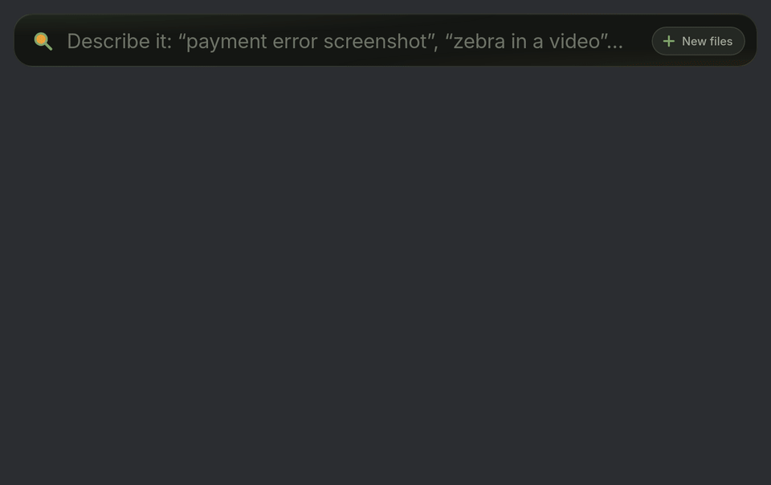
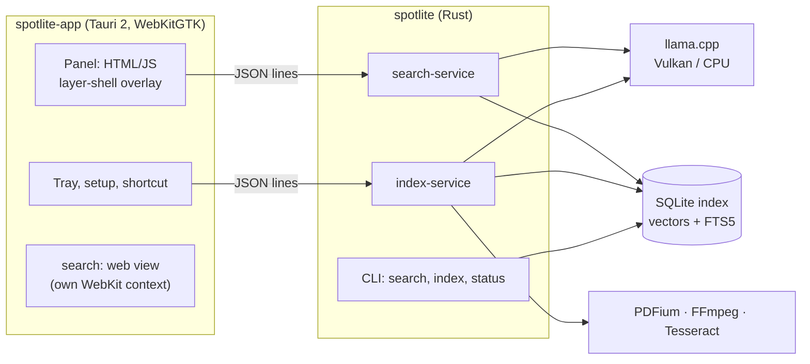

<p align="center">
  
</p>

<h1 align="center">SpotLite</h1>

<p align="center">
  Search your Linux files by what's in them: words, pictures, sound and code.<br>
  A Spotlight-style panel, on your machine, on your GPU. Your files never leave it.
</p>

<p align="center">
  
</p>

<p align="center"><sub>With sample files: a photo, the words in a screenshot, a PDF page (then Copy path), a moment in a
video, <code>code:</code>, and <code>search:</code>.</sub></p>

Press <kbd>Ctrl</kbd>+<kbd>Shift</kbd>+<kbd>Space</kbd>, describe what you remember ("the screenshot with the python
error", "a map of bus routes", "what to do when a volcano erupts"), and SpotLite finds the file, and the place in it: the
PDF page, the moment in the video, the line of code. It is inspired by [DigUp](https://github.com/ARahim3/DigUp), a Mac
app by Abdur Rahim, and builds on its design; SpotLite is a Linux app with a search engine of its own, in Rust.

## What it does

- **Meaning, not only names.** Photos, screenshots, PDFs (page by page), Word/ODT/RTF/Markdown/HTML/text, audio, and
  video (its frames and its sound) are embedded with Google's EmbeddingGemma 2, so "a dog on a beach" finds the photo
  and "the part about salaries" finds the page.
- **Your exact words first.** When the words you type are in a file (a project name, an error message), that file
  ranks above files that only mean something similar. Words in screenshots and scans count too (Tesseract OCR).
- **Opens at the place.** Enter opens a result in *your* default app, at the PDF page (Evince also highlights your
  words), the moment of a video (VLC, mpv, Celluloid) or the line of code (VS Code, gedit, Kate, Zed), when that app
  can be told where.
- **`code:` searches your code.** Choose your code folders (tray → Code Folders…); git-ignored files and secrets are
  left out. A function's name opens where it is defined. Tray → Index Code turns code indexing off and on.
- **`search:` searches the web, inside the panel.** Google's real results show in the panel; links open right there.
  <kbd>Shift</kbd>+<kbd>Enter</kbd> opens a bigger SpotLite browser window, <kbd>Ctrl</kbd>+<kbd>Enter</kbd> your own
  browser (Chrome, Brave and Chromium in their main profile).
- **Copy a file's path.** "Copy path" (or <kbd>Ctrl</kbd>+<kbd>Shift</kbd>+<kbd>C</kbd>) puts the result's full path
  on the clipboard.
- **Only what's new.** "New files" in the panel (or the tray) reads only the files added or changed since last time.
- **For scripts and AI agents too.** `spotlite search "…"` in a terminal; `--text` prints the matched page or lines,
  `--json` every field. A [Claude Code skill](skills/spotlite/SKILL.md) is included.
- **GPU or CPU.** llama.cpp on Vulkan (NVIDIA, AMD or Intel), and the CPU when there's no GPU or no room on it.

## Install

SpotLite runs on x86-64 Linux with a Wayland or X11 desktop. It is tested on Pop!_OS 24.04 (COSMIC) and Ubuntu 24.04.

1. Install what it runs on (Ubuntu/Debian names; Tesseract is optional, for the words in screenshots and scans):

   ```bash
   sudo apt install libwebkit2gtk-4.1-0 libayatana-appindicator3-1 libgomp1 libvulkan1 ffmpeg tesseract-ocr
   ```

2. Download the build from the [latest release](https://github.com/xafold/SpotLite/releases/latest)
   (`spotlite-0.1.0-linux-x86_64.tar.gz`, about 34 MB, and its `.sha256` file), or in a terminal:

   ```bash
   curl -LO https://github.com/xafold/SpotLite/releases/latest/download/spotlite-0.1.0-linux-x86_64.tar.gz
   curl -LO https://github.com/xafold/SpotLite/releases/latest/download/spotlite-0.1.0-linux-x86_64.tar.gz.sha256
   sha256sum -c spotlite-0.1.0-linux-x86_64.tar.gz.sha256
   ```

   The check prints `spotlite-0.1.0-linux-x86_64.tar.gz: OK`.

3. Unpack it and run its install script (no root needed; it installs in `~/.local`):

   ```bash
   tar -xzf spotlite-0.1.0-linux-x86_64.tar.gz
   ./spotlite-0.1.0-linux-x86_64/install.sh
   ```

4. SpotLite starts in the tray and asks which folders to search. The first start downloads the model (about 865 MB,
   checked against its SHA-256), then indexes in the background.

5. Press <kbd>Ctrl</kbd>+<kbd>Shift</kbd>+<kbd>Space</kbd>. The install sets this shortcut on COSMIC and GNOME; on other
   desktops, bind `~/.local/lib/spotlite/spotlite-app --panel` to a key.

### Command line only

Only the `spotlite` command, without the tray app and the panel: for servers, scripts and AI agents. It does not need
WebKitGTK or a tray.

1. Install what it runs on (Tesseract is optional):

   ```bash
   sudo apt install libgomp1 libvulkan1 ffmpeg tesseract-ocr
   ```

2. Download and check the release, as in step 2 above.

3. Unpack it and install only the command:

   ```bash
   tar -xzf spotlite-0.1.0-linux-x86_64.tar.gz
   ./spotlite-0.1.0-linux-x86_64/install.sh --cli
   ```

4. Download the model once (about 865 MB), then index your folders:

   ```bash
   spotlite download-model
   spotlite index ~/Documents ~/Pictures ~/Videos
   spotlite index --code ~/code          # optional, for "code:" searches
   ```

   Run `spotlite index` again to read new and changed files. It skips the files it has already read, and it leaves
   the folders you don't name alone.

5. Search:

   ```bash
   spotlite search "what to do when a volcano erupts"
   ```

6. Optional, for Claude Code: install the skill, so the agent uses `spotlite search` when you ask it to find
   something of yours.

   ```bash
   mkdir -p ~/.claude/skills/spotlite
   cp spotlite-0.1.0-linux-x86_64/SKILL.md ~/.claude/skills/spotlite/
   ```

To update, run the new release's `install.sh` (with `--cli` for the command only). To remove SpotLite: `rm -rf ~/.local/lib/spotlite ~/.local/bin/spotlite
~/.local/share/applications/spotlite.desktop ~/.config/autostart/spotlite.desktop`, and the folders in
[Where SpotLite keeps its files](#where-spotlite-keeps-its-files) for the index, the model and the settings.

## Use

| Type or press | What happens |
|---|---|
| a description, or words you remember | files, best first; the preview shows the page, frame or lines |
| <kbd>↑</kbd> <kbd>↓</kbd>, <kbd>Enter</kbd> | choose a result; open it at its page, moment or line |
| <kbd>Ctrl</kbd>+<kbd>Enter</kbd> | show it in your file manager |
| <kbd>Ctrl</kbd>+<kbd>Shift</kbd>+<kbd>C</kbd> | copy its full path |
| `code: retry with backoff` | search your code (by what it does, or a name) |
| `search: best hiking trails` | Google's results in the panel; <kbd>Shift</kbd>+<kbd>Enter</kbd> a bigger window, <kbd>Ctrl</kbd>+<kbd>Enter</kbd> your browser |
| **+ New files** | index only what's new or changed |
| <kbd>Esc</kbd> | close the panel |

From a terminal (or an agent):

```console
$ spotlite search "what to do when a volcano erupts" -n 1
 1. pdf        /home/you/Documents/Papers/volcano-guide.pdf  [p. 1]   (z 4.0, words #1)
      “…If the «volcano» «erupts», follow the marked evacuation routes downhill. Stay away…”

$ spotlite search "code: retry a failed call" -n 1
 1. code       /home/you/code/billing/retry.py  [lines 1–14, opens at 5]   (z 1.0, words #1)
      “…def «retry»_with_backoff(«call», attempts=5): """«Retry» a «failed» «call», waiting…”

$ spotlite search "dentist invoice" --kind pdf,doc --text -n 1     # the whole matched page
$ spotlite search "code: parse the config file" --json             # every field, for scripts
$ spotlite status                                                  # what's in the index
```

For Claude Code, copy [`SKILL.md`](skills/spotlite/SKILL.md) (also in the release download) to
`~/.claude/skills/spotlite/`. The agent then uses SpotLite whenever you ask it to find something of yours.

### Where SpotLite keeps its files

Your files and the index stay on your computer. SpotLite uploads none of them.

| What | Where |
|---|---|
| The index of your files | `~/.local/share/spotlite/index/index.sqlite` |
| The index of your code (`code:`) | `~/.local/share/spotlite/index/code.sqlite` |
| Page, frame and photo previews | `~/.local/share/spotlite/index/previews/` |
| The model | `~/.local/share/spotlite/Models/` (about 865 MB) |
| `search:`'s web pages (cookies, cache) | `~/.local/share/spotlite/browser/` and `~/.local/share/spotlite/panel-web/` |
| Settings: folders, code folders, Index Code, shortcut | `~/.config/com.xafold.spotlite/settings.json` |
| Logs | `~/.local/share/com.xafold.spotlite/logs/` (the app and its helpers), `~/.local/share/spotlite/index/worker*.log` (the model) |
| The app and the engine | `~/.local/lib/spotlite/` (`spotlite` in `~/.local/bin` links to the engine) |

With `$XDG_DATA_HOME` or `$XDG_CONFIG_HOME` set, those folders take the place of `~/.local/share` and `~/.config`.
`spotlite … --index FOLDER` uses another index folder. The index takes about 90 MB for the 579 files in the
[benchmark](#benchmark). To index everything again from the start, quit SpotLite, delete
`~/.local/share/spotlite/index/`, and start SpotLite.

## GPU and CPU

SpotLite runs the model with [llama.cpp](https://github.com/ggml-org/llama.cpp), loading its backend when it starts:

- **Vulkan** (the release build): any GPU with a Vulkan driver, NVIDIA, AMD or Intel. Search needs about 450 MB of GPU
  memory, indexing about 1.4 GB.
- **CPU**: when there's no GPU, when the GPU doesn't have that much memory free (a browser or a game is using it), or
  when you ask for it with `SPOTLITE_CPU=1`. The CPU build has a variant for every x86-64 generation (AVX2, AVX-512…)
  and picks the best one. Results are the same; it is slower (see the benchmark).
- **CUDA**: build from source with `nvcc` on the PATH (`scripts/build-llama.sh` picks it).

## Models

| | |
|---|---|
| Embeddings | [EmbeddingGemma 2](https://huggingface.co/google/embeddinggemma-2) (Google), about 740M parameters, 768-dimension vectors, one space for text, images and audio |
| Files | [`ggml-org/embeddinggemma-2-GGUF`](https://huggingface.co/ggml-org/embeddinggemma-2-GGUF), Q8_0: the text model (310 MB) and the multimodal projector for pictures and sound (555 MB), at a pinned revision, checked by SHA-256 |
| Where | `~/.local/share/spotlite/Models` (or the Hugging Face cache; `SPOTLITE_MODELS` points elsewhere) |
| Words in images | [Tesseract](https://github.com/tesseract-ocr/tesseract), English by default (`SPOTLITE_OCR_LANGS=eng+deu`) |
| PDFs | [PDFium](https://pdfium.googlesource.com/pdfium/) for text and page images; scanned pages go through OCR |
| Audio and video | [FFmpeg](https://ffmpeg.org) for frames (one per shot, at most every 3 s) and sound (30 s windows) |

The model is used under the [Gemma Terms of Use](https://ai.google.dev/gemma/terms).

## Architecture



- **The app** (`app/`) is a Tauri 2 shell: the panel and setup pages, the tray, folder watching, and opening results at
  their place in your default app. On COSMIC, KDE, Sway and Hyprland the panel is a layer-shell overlay
  (gtk-layer-shell), so it can grow from the search field to the results. The `search:` web views have WebKit contexts
  of their own: the websites in them get none of the app's file access or commands.
- **The engine** (`engine/`) is one Rust binary. `index-service` crawls the chosen folders and embeds what's new:
  pictures, PDF pages (text, or the page image when it's a scan), document passages, video frames and sound windows,
  code stretches. `search-service` keeps the index and the text encoder loaded and answers the panel in milliseconds;
  it lets go of the GPU after 5 minutes without a search.
- **The index** is SQLite: files, segments (a page, a frame, a passage, lines of code) with float16 vectors, and an FTS5
  table (Porter stemming) of the words.
- **Ranking** blends both: each segment's meaning score (how far its similarity stands out from the rest, in standard
  deviations) and the query's words. Rare words count more than common ones, a file with all the words together ranks
  first, and a page without the query's most specific word ("spiderman" among "taken into hospital") counts for less.

## Benchmark

Measured on a laptop: Intel Core i7-12700H, NVIDIA GeForce RTX 3050 Ti Laptop GPU (4 GB), 24 GB RAM, Pop!_OS 24.04,
the release build. The search numbers are over a real personal index: 579 files (screenshots, photos, PDFs with
books among them, documents, recordings and films), 19,340 vectors, 95 MB.

**Search** (the panel's helper, warm; 100 queries each):

| | GPU (Vulkan) | CPU (`SPOTLITE_CPU=1`) |
|---|---|---|
| Words, while you type (p50 / p95) | 13 ms / 32 ms | 13 ms / 33 ms |
| Meaning, a new query each time (p50 / p95) | 17 ms / 36 ms | 32 ms / 55 ms |
| … of which embedding the query (p50) | 6 ms | 19 ms |
| `spotlite search` from a terminal (model load included) | 1.1 s | 1.2 s |

**Indexing** (the same files both times; per file, OCR included):

| | GPU (Vulkan) | CPU |
|---|---|---|
| Screenshot (40, up to 2560 px) | 0.61 s | 5.5 s |
| Photo (9) | 0.18 s | 2.3 s |
| Video clip, 8 s (2) | 0.39 s | 3.4 s |
| PDF pages (a 322-page book and a 14-page paper) | 28 pages/s | 1.6 pages/s |

**Memory**: the app at rest about 400 MB of RAM and no CPU; the search helper about 420 MB of RAM and 240 MB of GPU
memory while warm (it exits after 5 minutes without a search); indexing 500–650 MB of RAM and about 1.3 GB of GPU memory.

**Does it find the right thing?** 24 real-life searches over that index (exact names and phrases, the words in a
screenshot, descriptions of photos, video moments and PDF pages, code by name and by what it does): all 24 put the
expected file at the expected rank, 22 of them first. Before the word rules (rare words, all the words together, the
query's subject), the same check passed 20 of 23.

## Build from source

```bash
git clone https://github.com/xafold/SpotLite && cd SpotLite
scripts/fetch-pdfium.sh                  # PDFium, prebuilt
scripts/fetch-vulkan.sh                  # Vulkan build tools, without root (skip for a CPU-only build)
scripts/build-llama.sh                   # llama.cpp, pinned and patched, into Vendor/llama
(cd engine && cargo build --release)
(cd app/src-tauri && cargo build --release)
scripts/install.sh                       # installs what you built
```

Building the app needs `libwebkit2gtk-4.1-dev libayatana-appindicator3-dev librsvg2-dev libxdo-dev libssl-dev`, Rust
1.85+, cmake (or uv), and git. `scripts/package.sh` makes the release archive.

Tests: `scripts/test.py --ui` builds a folder of every kind of file, indexes it into an index of its own, and checks
search, OCR, incremental indexing, the services, code search, and the panel in a headless Weston (sizes, opening at the
place with stand-in default apps, `search:`). It needs ffmpeg, ImageMagick, weston and Tesseract.

## Credits

SpotLite is inspired by [DigUp](https://github.com/ARahim3/DigUp) by Abdur Rahim (MIT), and builds on it: the app shell,
the panel's behavior, the index schema and the search pipeline started from DigUp's, before the engine was rewritten in
Rust for Linux. Built on [llama.cpp](https://github.com/ggml-org/llama.cpp),
[EmbeddingGemma](https://huggingface.co/google/embeddinggemma-2), [Tauri](https://tauri.app),
[WebKitGTK](https://webkitgtk.org), [gtk-layer-shell](https://github.com/wmww/gtk-layer-shell),
[PDFium](https://pdfium.googlesource.com/pdfium/), [SQLite](https://sqlite.org), [FFmpeg](https://ffmpeg.org) and
[Tesseract](https://github.com/tesseract-ocr/tesseract).

## License

[MIT](LICENSE).
